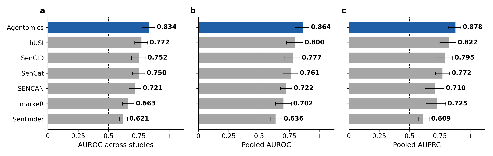

# senBench

senBench is a benchmark of methods that call a bulk RNA-seq sample of cultured human cells senescent or not senescent. A method receives the raw read counts of one sample and returns a score that is higher for senescent samples. senBench holds public datasets from GEO and ArrayExpress with a label for every sample and a split of the datasets by laboratory. It compares Agentomics, a model that the agent system Agentomics-ML built on the training data, with six published tools on the held-out part `test` (687 samples of 78 datasets from 71 laboratory groups).

## Quick start

```
bash download.sh
bash build.sh
bash run.sh
```

The three commands need Linux (x86-64) with bash, python3, git and curl. `download.sh` downloads the public files into `downloads/` (18.76 GiB). `build.sh` builds the count tables, the split, the training data and `test` into `build/`, and compares each output with the sha256 of our build. `run.sh` installs our model and the six tools, scores `test` with each into `predictions/`, and writes `results.tsv`; `bash run.sh SenCID` runs one method.

## Results



- **AUROC across studies:** the probability that a senescent sample of one study scores higher than a not senescent sample of a study from another laboratory group, averaged over all such pairs of studies.
- **Pooled AUROC:** the probability that a senescent sample scores higher than a not senescent sample, with all samples in one ranking.
- **Pooled AUPRC:** the average precision with which that ranking finds the senescent samples; a random score gives about 0.5.
- **Error bars:** the 95% interval over 2,000 resamples of the laboratory groups. The dashed line is the score of a random method. markeR gave no score for 42 samples and is scored on the other 645. `results.tsv` holds every value with its interval, and Agentomics minus each tool.

## Folders

- `pipeline/`: the code that downloads, builds, predicts and scores, with the labels and the other input tables.
- `agentomics_model/`: the code and the trained model of Agentomics.
- `tools/`: for each published tool, its install script and the script that runs it on a count table.
- `predictions/`: the score that each method gave each `test` sample.

The code of this repository is under the MIT licence (`LICENSE`); each tool keeps its own licence.
